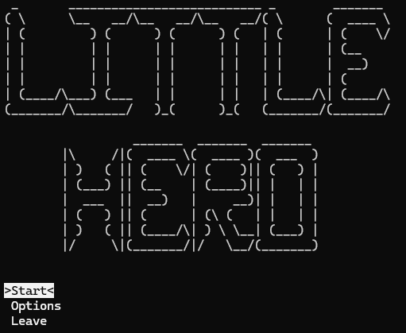
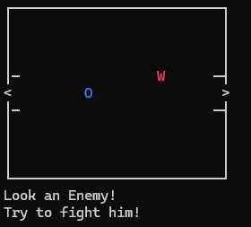
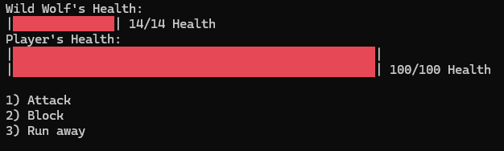
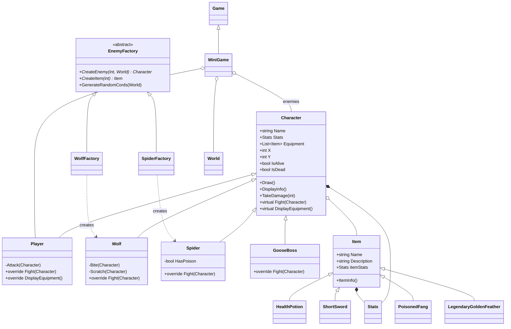

# Little Hero

A turn-based, console RPG written in **C# / .NET**. Explore six ASCII dungeons, fight wolves and spiders, collect loot, level up and defeat the **Mad Goose** in the boss cave.

The project was built to practice **object-oriented programming** in C#: inheritance, polymorphism, encapsulation, abstraction and the Factory Method design pattern.







---

## Play the game

1. Go to the **[Releases page](../../releases/latest)**.
2. Download **`LittleHero-win-x64.zip`**.
3. Unzip it anywhere.
4. Double-click **`LittleHero.exe`**.

That's it. The release is *self-contained*, so you **do not need to install .NET** or any other tools. Requires Windows 10/11 (64-bit).

> **Windows SmartScreen warning?** The `.exe` is not code-signed, so Windows may show "Windows protected your PC". Click **More info → Run anyway**. You can inspect the whole source code in this repository, and the executable is built automatically by GitHub Actions (see [`.github/workflows/release.yml`](.github/workflows/release.yml)).

> **Tip:** For the best look, run the game in **Windows Terminal** (default on Windows 11).

---

## How to play

| Key | Action |
|---|---|
| `↑` `↓` | Navigate menus |
| `Enter` | Confirm |
| `←` `↑` `→` `↓` | Move the hero (`O`) |
| `E` | Open / close character screen and inventory |
| `B` | (On the character screen) open the backpack and use items |
| `1` / `2` / `3` | In battle: Attack / Block / Run away |

**Goal:** walk through the exits (`>`) of all six levels, survive the wolves and spiders, and defeat the boss waiting at `B` in the last cave.

**Map legend**

| Symbol | Meaning |
|---|---|
| `O` | You |
| `W` | Wolf |
| `S` | Spider |
| `>` / `<` | Next / previous level |
| `B` | Boss cave entrance |

**Game mechanics**

- Hit chance is `50% + AttackSpeed`. Missing is part of the game!
- Enemies spawn on random free tiles of each map every time you enter a level.
- Defeated enemies give **gold**, **experience** and a random **drop** (70 % health potion, otherwise a weapon).
- Level-up threshold is `Level²` experience points; every level-up increases your attack damage.
- From level 5 spiders are **poisonous** and deal double damage.
- Health potions heal 10 HP (capped at your max HP).

---

## Repository structure

```
LittleHero/
├── .github/
│   └── workflows/
│       ├── build.yml          # CI: build on every push / pull request
│       └── release.yml        # builds the .exe and publishes a GitHub Release on tag v*
├── docs/
│   └── screenshots/           # images used in this README
├── src/
│   └── LittleHero/
│       ├── Program.cs         # entry point
│       ├── Game.cs            # menus, battle loop, XP / level-up, game-over screens
│       ├── MiniGame.cs        # exploration game loop (extends Game)
│       ├── World.cs           # tile map, collision checks, drawing
│       ├── LevelParser.cs     # reads Level*.txt into a 2D array
│       ├── Menu.cs            # reusable arrow-key menu
│       ├── Character.cs       # base class for every creature
│       ├── Player.cs          # Character → the hero
│       ├── Wolf.cs            # Character → wolf
│       ├── Spider.cs          # Character → spider
│       ├── GooseBoss.cs       # Character → final boss
│       ├── Stats.cs           # stats container + presets
│       ├── Item.cs            # base class for items
│       ├── HealthPotion.cs    # Item → potion
│       ├── ShortSword.cs      # Item → weapon
│       ├── PoisonedFang.cs    # Item → spider drop
│       ├── LegendaryGoldenFeather.cs
│       ├── EnemyFactory.cs    # abstract factory base
│       ├── WolfFactory.cs     # creates wolves + their loot
│       ├── SpiderFactory.cs   # creates spiders + their loot
│       ├── AsciiArt.cs        # ASCII art (logo, enemies, screens)
│       ├── Level1.txt … Level6.txt   # level maps (plain text)
│       └── LittleHero.csproj
├── .gitattributes
├── .gitignore
├── LICENSE
├── LittleHero.slnx
└── README.md
```

---

## Object-oriented design

### Class diagram



### 1. Inheritance

Common behaviour lives in a base class; concrete types only add what makes them different.

- `Character` → `Player`, `Wolf`, `Spider`, `GooseBoss`
- `Item` → `HealthPotion`, `ShortSword`, `PoisonedFang`, `LegendaryGoldenFeather`
- `EnemyFactory` → `WolfFactory`, `SpiderFactory`
- `Game` → `MiniGame`

Derived classes reuse the base constructor via **constructor chaining**:

```csharp
class Wolf : Character
{
    public Wolf(Stats _stats, List<Item> _equipment, int _initialX, int _initialY)
        : base("Wild Wolf", AsciiArt.Wolf, _stats, _equipment, _initialX, _initialY, "W", ConsoleColor.Red)
    { }
}
```

### 2. Polymorphism

`Character.Fight()` is `virtual`; each creature overrides it with its own combat behaviour:

| Class | Behaviour in `Fight()` |
|---|---|
| `Player` | Reads keyboard input: attack, block or run |
| `Wolf` | 50 % `Bite` (full damage) / 50 % `Scratch` (half damage) |
| `Spider` | `Bite` – full damage if poisonous, half otherwise |
| `GooseBoss` | Always uses `MASSIVEHONK` (never misses) |

The battle loop in `Game.BattleCurrentEnemy` does not know (or care) which enemy it is fighting:

```csharp
player.Fight(enemy);   // resolved at runtime to Player.Fight
...
enemy.Fight(player);   // Wolf.Fight, Spider.Fight or GooseBoss.Fight
```

Adding a new monster does not require touching the battle code. `DisplayEquipment()` is also overridden: `Player` shows an interactive backpack menu, whereas other characters just list their loot.

### 3. Encapsulation

- State is exposed via **properties** with restricted setters (`protected set`), so only a character and its subclasses can change its name, stats or equipment from the inside.
- Attack implementations (`Attack`, `Bite`, `Scratch`, `MASSIVEHONK`) are `private` — the outside world only sees `Fight()`.
- Computed, read-only properties such as `IsAlive` / `IsDead` hide the "health ≤ 0" rule:

```csharp
public bool IsDead  { get => Stats.Health <= 0; }
public bool IsAlive { get => Stats.Health > 0; }
```

- `TakeDamage()` is the single place that changes health and clamps it at 0.

### 4. Abstraction & the Factory Method pattern

`EnemyFactory` is an **abstract class** that defines *what* a factory must do, while subclasses decide *how*:

```csharp
abstract class EnemyFactory
{
    public abstract Character CreateEnemy(int stage, World world);
    public abstract Item CreateItem(int stage);
    public (int, int) GenerateRandomCords(World world) { /* shared logic */ }
}
```

- `WolfFactory` creates wolves and drops potions / short swords.
- `SpiderFactory` creates spiders (poisonous from stage 5) and drops potions / poisoned fangs.

Enemy stats scale with the level (`stage`), and the shared "pick a random free tile" logic is implemented once in the base class.

### 5. Composition

Objects are built from smaller objects ("has-a" relationships):

- `Character` **has** `Stats` and a `List<Item>` inventory.
- `Item` **has** `Stats` (a sword's bonus is just another `Stats` instance).
- `MiniGame` **has** a `World`, a `Player` and a list of enemies.
- `World` **has** a 2D `string[,]` grid built by `LevelParser`.

### 6. Other C# features used

- **Static members** – `Stats.BasicPlayerStats`, `Stats.BasicWolfStats` (preset data) and the static utility class `LevelParser`.
- **Generics** – `List<Item>`, `List<Character>`, `List<string>`.
- **Tuples** – `(int, int) GenerateRandomCords(...)`.
- **Multidimensional arrays** – `string[,]` for the tile map.
- **File I/O** – levels are plain `.txt` files, so new maps can be added without recompiling logic.
- **Expression-bodied members**, **string interpolation** and **verbatim strings** (`@"..."`).
- **Console API** – `Console.ReadKey`, `SetCursorPosition`, foreground/background colours for the UI.
- **Reusable UI component** – the `Menu` class renders any list of options and returns the selected index.

---

## Build from source

Requirements: [.NET 10 SDK](https://dotnet.microsoft.com/download).

```bash
git clone https://github.com/KacperTelesz/LittleHero.git
cd LittleHero
dotnet run --project src/LittleHero
```

Or open `LittleHero.slnx` in Visual Studio 2026 and press **F5**.

Create your own standalone Windows build:

```bash
dotnet publish src/LittleHero -c Release -r win-x64 --self-contained true -p:PublishSingleFile=true -o publish
```

The `publish/` folder will contain `LittleHero.exe` and the `Level*.txt` files. Keep them together.

### Publishing a new release

```bash
git tag v1.0.0
git push origin v1.0.0
```

GitHub Actions builds the game and attaches `LittleHero-win-x64.zip` to a new Release automatically.

---

## Roadmap / ideas for improvement

This is a learning project, and there are things I would do differently today:

- Implement **Block** (currently it only skips the turn), **Options** and **Load / Save game** (menu entries exist as placeholders).
- Let the player **equip** dropped weapons (items already carry `Stats`; only potions are usable right now).
- Replace the static `Stats` presets with factory methods so that every character gets its own `Stats` instance.
- Introduce an `IFightable` / `IItem` interface and favour composition over inheritance where it makes sense (e.g. `MiniGame` currently extends `Game` only to reuse helper methods).
- Remove duplicated code in `Character.DisplayEquipment` and `Player.DisplayEquipment`.
- Replace magic numbers (map size used for spawning, hit-chance formula) with constants/configuration.
- Add unit tests for combat and stat-scaling logic.

---

## License

Released under the [MIT License](LICENSE).
